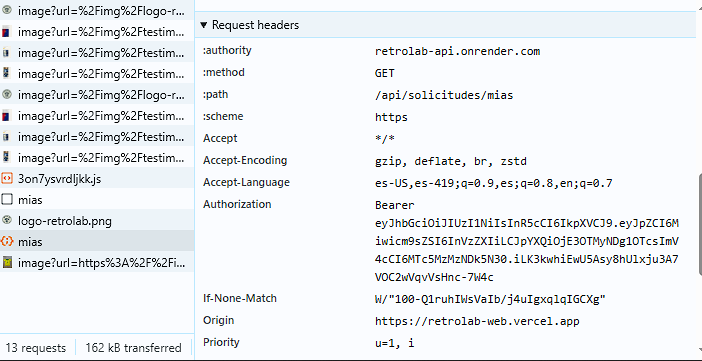

# RetroLab · Frontend

El sitio de **RetroLab** de la Entrega 1 (tienda de camisetas retro de fútbol), reconstruido en **Next.js (App Router) + TypeScript + Tailwind**. Tiene el mismo contenido, la misma paleta y las mismas fuentes que la Entrega 1, pero ahora el catálogo, el formulario y las cuentas de usuario funcionan con mi propia API.

- **Sitio en Vercel:** https://retrolab-web.vercel.app
- **API en producción:** https://retrolab-api.onrender.com
- **Repositorio del backend:** https://github.com/suribe27/retrolab-api

> La API está en el plan gratis de Render: si lleva un rato sin uso, el catálogo puede tardar unos 50 segundos en cargar la primera vez.

## Qué tiene

- Inicio con el hero, "Sobre RetroLab", los testimonios y el formulario "¿No encontraste tu camiseta?", que ahora crea una **solicitud** en la API (requiere sesión).
- Catálogo cargado desde la API, con paginación por URL (`?page=2`), filtros combinados (categoría, texto y rango de precio) y estados de cargando, vacío y error.
- Registro e inicio de sesión con validación y errores junto a cada campo (por ejemplo, "Este correo ya está registrado" debajo del correo).
- Sesión persistente al refrescar. La barra de navegación cambia según la sesión: un invitado ve "Ingresar"; un usuario ve su nombre, "Mis solicitudes" y "Salir"; el admin ve además "Administración".
- `/mis-solicitudes`: solo con sesión.
- `/admin`: solo rol admin. Tiene el CRUD del catálogo (con confirmación antes de eliminar) y el listado de todas las solicitudes.
- Con sesión activa, `/login` y `/registro` redirigen al inicio.
- Página 404 propia.
- Responsive: 2 columnas en móvil, 3 en tablet y 4 en escritorio, con menú hamburguesa en móvil.

## Estructura

```
app/                       rutas (los page.tsx solo componen componentes)
proxy.ts                   protección de rutas en el servidor (lee el token de la cookie)
src/features/
├── common/                config.ts · http.ts · session.ts · components/ (Navbar, Pagination, Button, Field…) · hooks/
├── auth/                  domain/ · services/ · hooks/useAuth · components/ (LoginForm, RegisterForm, RouteGuards)
├── camisetas/             domain/ · services/ · hooks/ · components/ (CamisetaCard, CatalogoView, CamisetaForm…)
├── solicitudes/           domain/ · services/ · hooks/ · components/ (SolicitudForm, SolicitudesList…)
├── home/                  secciones del inicio
└── admin/                 panel de administración
```

Ningún componente llama a `fetch` directamente: los componentes usan hooks, los hooks usan services y los services usan el cliente `http.ts`. Ese cliente agrega `Authorization: Bearer <token>` a cada petición; si la API responde 401, borra la sesión y lleva al usuario a `/login`.

## Correr en local

Requisitos: Node 20+ y la API corriendo (en local o la de Render).

```bash
npm install
cp .env.example .env.local     # NEXT_PUBLIC_API_HOST=http://localhost:3000 (o la URL de Render)
npm run dev                    # http://localhost:3001
```

### Variables de entorno

| Variable | Para qué |
|---|---|
| `NEXT_PUBLIC_API_HOST` | URL de la API, sin `/api` al final |

## Credenciales de prueba

Creadas por el seed del backend (solo para el ambiente de la entrega):

| Rol | Email | Contraseña |
|---|---|---|
| admin | `admin@retrolab.com` | `Admin123*` |
| user | `user@retrolab.com` | `User123*` |

## Decisiones técnicas

### Flujo completo de un login

En `/login`, el componente `LoginForm` valida primero que el correo tenga un formato válido y que la contraseña no esté vacía. Después llama a `login()` del hook `useAuth`, que usa `authService.login()`, y este usa el cliente `http.ts` para hacer `POST /api/auth/login`. En este caso le digo al cliente que un 401 **no** redirija, para poder mostrar "Credenciales inválidas" debajo del campo.

En la API, Zod valida el body. `AuthService` busca el usuario por email y compara la contraseña con `bcrypt.compare`; si coincide, firma un JWT con `JWT_SECRET`, que lleva solo `id` y `role` y expira en 1 día.

De vuelta en el frontend, `useAuth` guarda el token en una cookie (`session.ts`), guarda el usuario en el contexto y la navbar cambia según el rol. Cuando entro a una ruta protegida como `/mis-solicitudes`:
1. `proxy.ts` lee la cookie en el servidor y, si no hay token vigente, redirige a `/login`.
2. La página pide `GET /api/solicitudes/mias`, y `http.ts` agrega `Authorization: Bearer <token>`.
3. En la API, el middleware `auth` verifica el token y deja el usuario en `req.user`, y el controlador devuelve solo las solicitudes de ese usuario.

Al refrescar la página, `useAuth` lee el token de la cookie y llama a `GET /api/auth/me` para recuperar el usuario. Así la sesión no se pierde.

### ¿Dónde guardo el token y qué riesgo tiene?

En una cookie llamada `retrolab_token`, que se crea desde JavaScript con `SameSite=Lax`, `Secure` en https y la misma duración que el token. La elegí en vez de `localStorage` porque, además de sobrevivir al refrescar, `proxy.ts` la puede leer en el servidor y redirigir antes de mostrar una página privada.

El riesgo es que JavaScript sí puede leerla. Si el sitio tuviera una vulnerabilidad XSS, un script malicioso podría robar el token y usarlo hasta que expire. Lo mitiga que el token dura solo 1 día y que React escapa el contenido. Una opción más segura sería una cookie `httpOnly` creada por la API.

También tengo claro que ocultar botones o redirigir en el frontend es solo experiencia de usuario. La protección real está en la API: aunque alguien llame directamente a `DELETE /api/camisetas/:id`, la API responde 401 o 403.

### ¿Cuándo responde la API 401 y cuándo 403?

- **401**: la API no sabe quién eres. No hay token, el token es inválido o ya expiró, o el login tiene credenciales malas.
- **403**: la API sabe quién eres, pero tu rol no tiene permiso.

Ejemplo real que probé en producción: `DELETE /api/camisetas/3` **sin token** → **401**. La misma petición con el token de `user@retrolab.com` → **403**, porque el middleware `soloAdmin` solo deja pasar al rol `admin`. Si el frontend recibe un 401 en una ruta protegida (por ejemplo, porque el token expiró), `http.ts` cierra la sesión y manda al usuario a `/login`.

### Uso de IA

Usé IA (Claude) como apoyo. La usé para generar el código de cada parte siguiendo la organización por features que vimos en clase, guiarme en el despliegue y organizar la documentación. Fui aplicando el código por partes, y cada parte la probé en el navegador y revisé con `npx tsc --noEmit` antes de hacer commit.

Lo que tuve que corregir o resolver yo:
- **Tailwind no funcionaba.** Después de reemplazar `next.config.ts` y `globals.css`, la página salía sin estilos porque el proyecto no tenía la configuración de PostCSS para Tailwind. Lo resolví instalando `@tailwindcss/postcss` y creando `postcss.config.mjs`.
- **El catálogo no cargaba en Vercel.** En la consola vi que la petición iba a `retrolab-web.vercel.app/NEXT_PUBLIC_API_HOST/api/...`: la variable de entorno había quedado como tipo "Secret" y con el valor mal. La cambié a tipo "Config" con la URL de Render y volví a desplegar.
- **CORS.** Tuve que agregar la URL de Vercel en `FRONTEND_URL` en Render para que el sitio pudiera llamar a la API.
- **Imágenes.** Cambié las fotos de Cloudinary a ImageKit y corregí una camiseta (Argentina 1994) que tenía la URL y el año mal.
- **Git.** Al principio `create-next-app` creó el proyecto dentro de la carpeta del backend; tuve que moverlo e iniciar su propio repositorio.

## Captura de Network

Petición protegida a `GET /api/solicitudes/mias` desde el sitio en Vercel, con el header `Authorization: Bearer ...` agregado automáticamente por `http.ts`:


